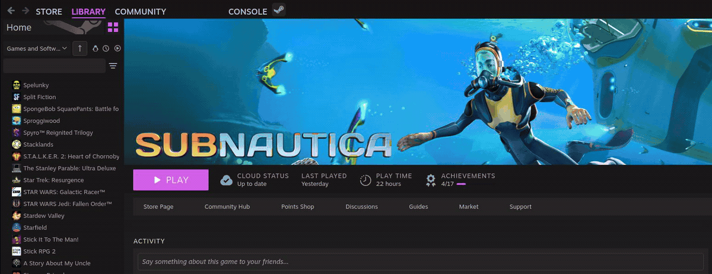
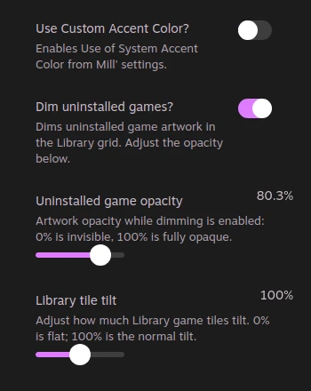
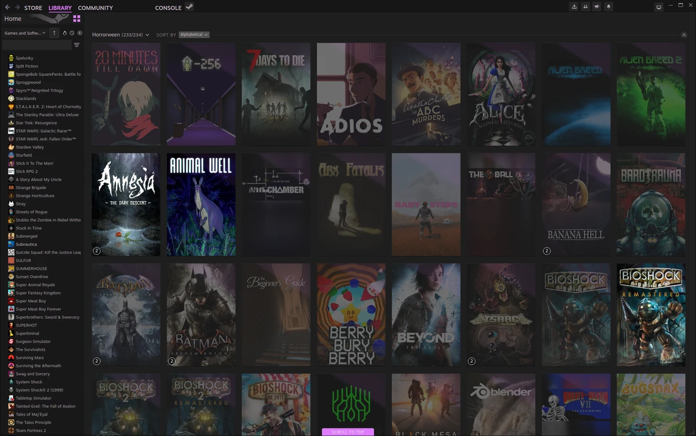
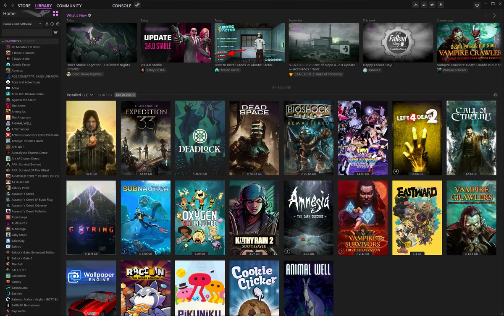
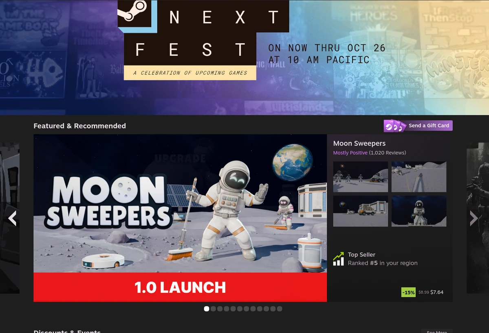
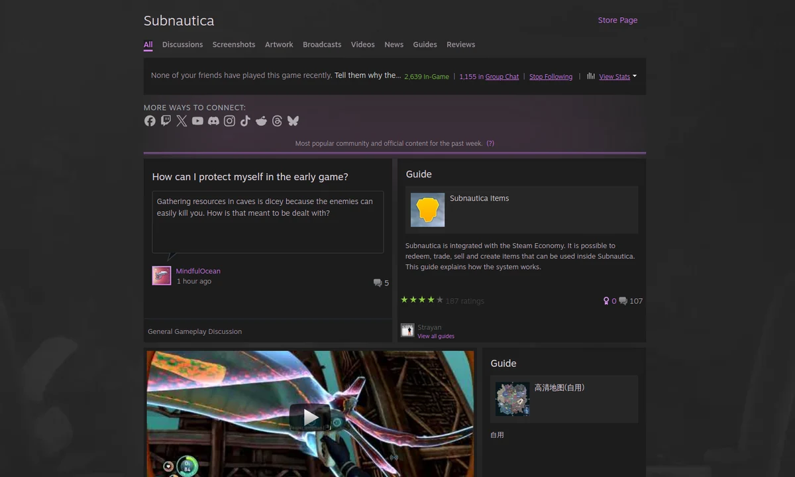
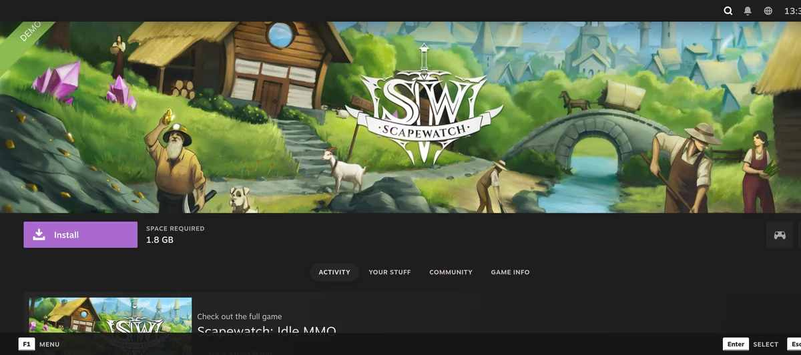
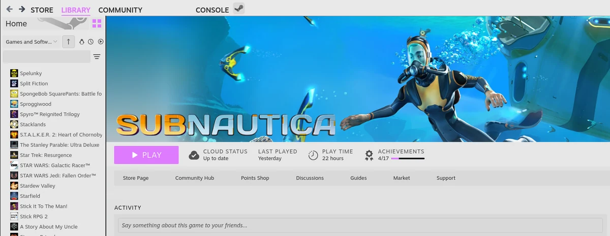
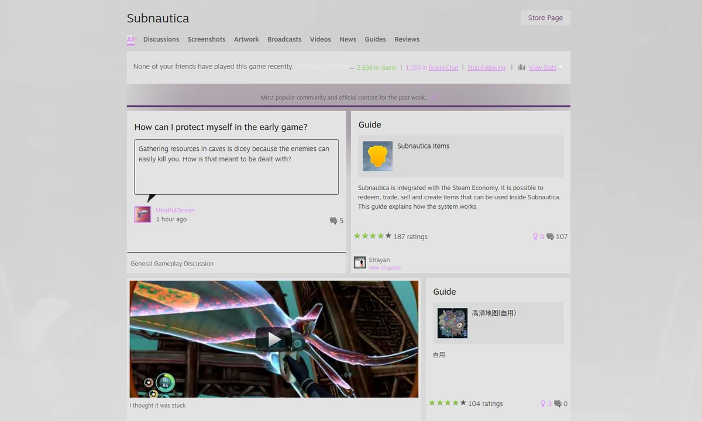

# Another Take On Metro Steam:
  

A theme for Steam, based on [The Unofficial Metro for Steam](https://steamcommunity.com/groups/metroskin/discussions/0/141136086931804907/) and [Steam Dark mode by AikoMidori](https://github.com/AikoMidori/steam-dark-mode).

<small>If you need support: you can find me as Plær1 in [The Unofficial Metro for Steam Discord](https://discord.gg/UZvkvkh).</small>

## Install:

1. [Install Millennium](https://docs.steambrew.app/users/guides/installing-addons).
2. Find ATOMS in Millennium's Themes, select it, and reload Steam's UI.

## Features:

* Use Millennium's accent picker: turn on **Use Custom Accent Color?** in ATOMS settings. Or customize the colors in `config.css`.
* Dim uninstalled games and adjust their artwork opacity in the ATOMS settings:

* Adjust how much Library tiles tilt with the **Library tile tilt** slider (0% is flat).

* Theme'd Library, Store, Community and Big Picture:

* Bottom menu buttons moved to the top, with a hidden root menu and Reload/Restart buttons.
* Skip the store age gate, use Ctrl + arrow keys in the discovery queue, and zoom web pages with Ctrl + + / - (Ctrl + 0 resets).
* Hides any personal ickyness from your own profile (the world still knows what you did).

## Known bugs/to-do's:

* Big Picture is still being refined.
* MacOS isn't fully tested; please let me know what's not working!
* The Reload and Restart translations are google translate, so help from anyone multilingual is appreciated.

If you find bugs, please report them or contact me on discord!

## Credits:

* [PhantomGamers](https://ko-fi.com/phantomgamers) for SFP, and being generally a cool guy.
* [Shiina](https://shiinaskins.com) for the Steam Dark Mode skin, which many pages in this project still use.
* [ShadowMonster99](https://ko-fi.com/shadowmonster) for Millennium, and being generally a cool guy.

## Light mode (experemental):

Turn on **Light mode?** in ATOMS settings and reload Steam's UI.

